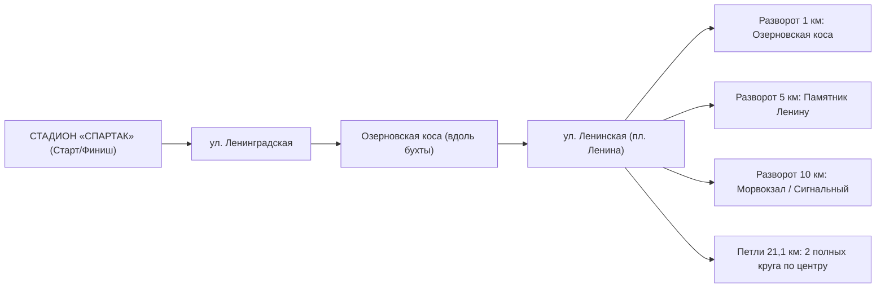
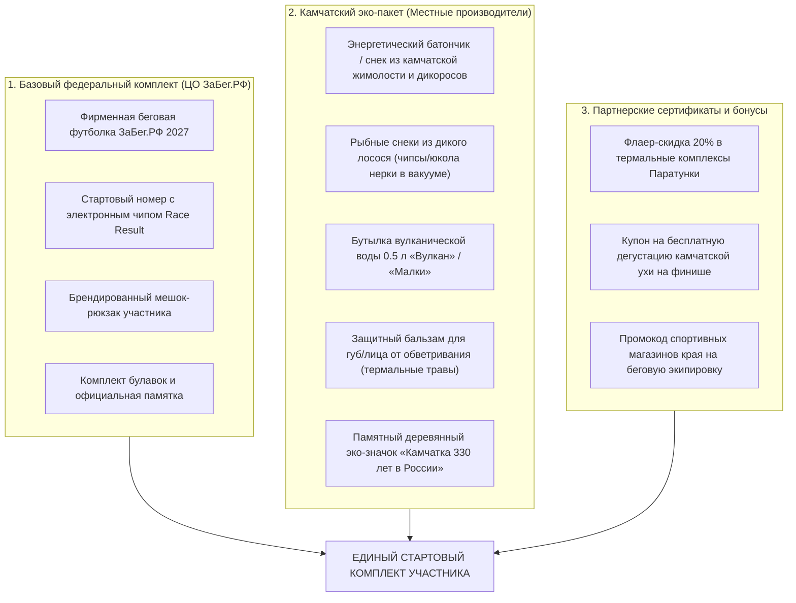
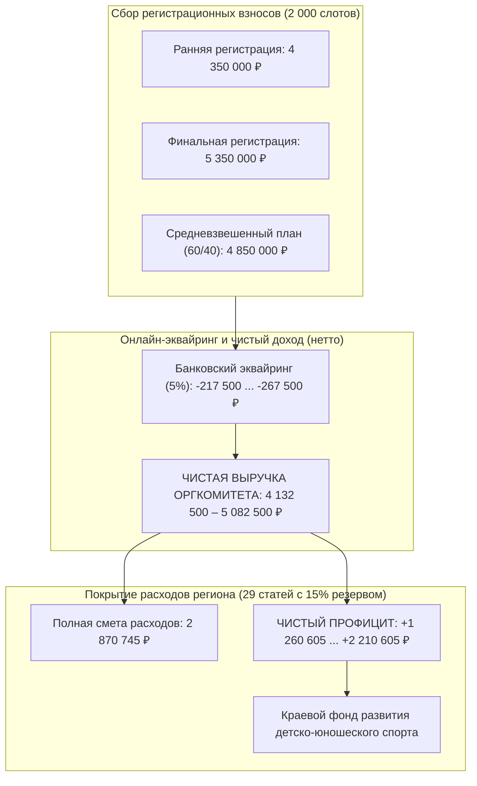
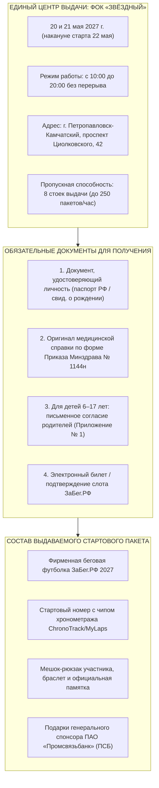
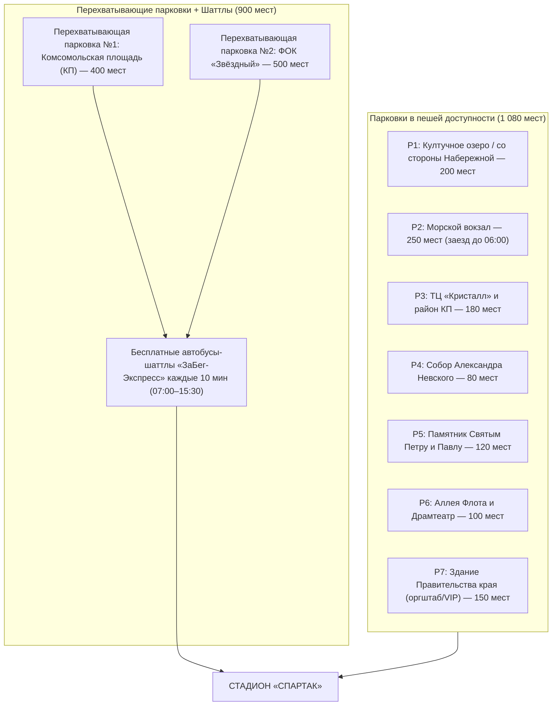
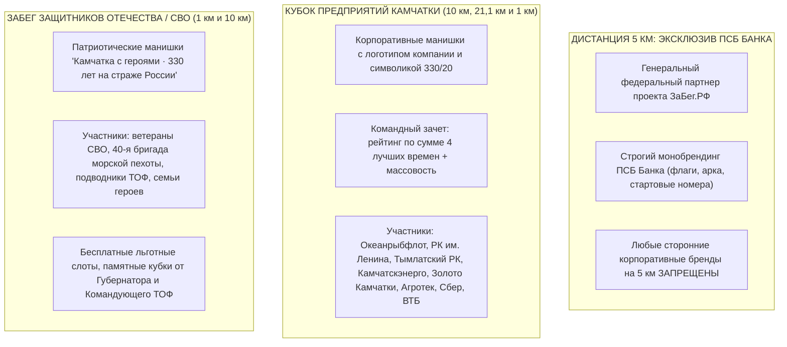

# ДОКЛАД МИНИСТРУ СПОРТА КАМЧАТСКОГО КРАЯ
## «ЗаБег.РФ — Камчатка 2027: Камчатка бежит навстречу 330-летию»
### Полная концепция, организация силами региона и финансовая модель на 2 000 участников

**АДРЕСАТ:** Министру спорта Камчатского края  
**ДАТА:** Ноябрь 2026 года  
**ДЕНЬ ЗАБЕГА:** 22 мая 2027 года  
**МЕСТО:** г. Петропавловск-Камчатский, стадион «Спартак»  
**СТАТУС:** Проект комплексного управленческого решения  

---

## 1. СУТЬ ПРЕДЛОЖЕНИЯ И ГЛАВНЫЙ ЭКОНОМИЧЕСКИЙ РЕЗУЛЬТАТ

Предлагается провести Всероссийский полумарафон «ЗаБег.РФ — Камчатка 2027» со стартом и финишем на стадионе «Спартак» по проверенной трассе 2026 года через исторический центр краевой столицы. Мероприятие приурочено к двум знаковым датам: **330 лет со времени вхождения Камчатки в состав России** и **20 лет со дня образования Камчатского края**.

### Ключевое решение:
Отказаться от привлечения коммерческих посредников и организационных операторов «под ключ» (в лице Ирины Агранат) и провести мероприятие **силами регионального организационного штаба (Минспорт края + КГАУ «ЦСП ПК» + Администрация ПКГО)** с прямыми договорами с профильными исполнителями по 44-ФЗ.

| Финансовый показатель | Смета Агранат 2027 | Самостоятельная модель 2027 | Экономический эффект |
| :--- | :---: | :---: | :---: |
| **Емкость участников** | 1 000 – 1 200 чел. | **2 000 человек** | Рост охвата в 2,2 раза |
| **Прямые расходы** | 5 008 248 ₽ | **2 496 300 ₽** | Снижение затрат на 50,2% |
| **Непредвиденный резерв** | 100 000 ₽ (2%) | **374 445 ₽ (15%)** | Надежный запас на форс-мажор |
| **Итого бюджет организатора** | **5 008 248 ₽** | **2 870 745 ₽** | **Чистая экономия: 2 137 503 ₽ (42,7%)** |
| **Себестоимость на 1 участника** | 2 504 ₽ | **1 435,37 ₽** | Эффективность бюджетного рубля |
| **Выручка от слотов (нетто 5% эквайринг)** | Забирает посредник | **4 132 500 – 5 082 500 ₽** | Покрывает смету региона на **143,9% – 177,0%** |
| **Чистая нагрузка на бюджет края** | **5 008 248 ₽** | **0 ₽ (100% самоокупаемость)** | Полная окупаемость за счет регистрационных взносов |
| **Чистый финансовый профицит (прибыль)** | 0 ₽ (убыток -5,01 млн ₽) | **+1 260 605 – +2 210 605 ₽** | Направляется в Краевой фонд развития детского спорта |
| **Совокупный экономический эффект** | Базовый уровень | **+6 268 853 – +7 218 853 ₽** | Экономия бюджета 5,01 млн ₽ + чистая прибыль от слотов |

---

## 2. ИНТЕРАКТИВНАЯ КАРТА, МАРШРУТ И ОГРАНИЧЕНИЕ ДВИЖЕНИЯ

Трасса 2027 года полностью наследует успешную конфигурацию 2026 года с общим стартом и финишем на стадионе «Спартак» и видовыми участками вдоль Авачинской бухты и Култучного озера.

### Параметры дистанций и разделение потоков:
1. **1 км (Семейный / Юниор — 800 чел.):** Старт на стадионе «Спартак» → выбег на ул. Ленинградскую → поворот на Озерновскую косу → разворот у памятника Василию Завойко / причалов → финиш на «Спартаке». Выпускается **4 волнами по 200 участников с интервалом 15 минут** для исключения детского травматизма и давки.
2. **5 км (Массовый старт ПСБ — 500 чел.):** «Спартак» → Ленинградская → Озерновская коса → ул. Ленинская → разворот на площади Ленина у здания Правительства края → возвращение по ул. Ленинской и Озерновской косе на «Спартак».
3. **10 км (Спортивный забег — 500 чел.):** Трасса 5 км с продлением по ул. Ленинской и ул. Красинцев до Морского вокзала и Мыса Сигнальный с 1 промежуточным пит-стопом.
4. **21,1 км (Полумарафон — 200 чел.):** 2 круга по сертифицированному десятикилометровому кольцу с 3 пунктами гидратации и питания.

### График и схема перекрытия движения транспорта:
- **Интервал ограничений:** **06:00 – 14:30** (22 мая 2027 г.).
- **Перекрываемые магистрали:** Участки ул. Ленинградской (от стадиона «Спартак»), ул. Озерновская коса, ул. Ленинская до Морвокзала.
- **Организация объезда:** Движение личного и общественного транспорта организуется по **ул. Советской** (двусторонний режим на период ограничений) и магистрали ул. Ключевская — ул. Высотная без остановки сообщения с южной частью города.
- **Безопасность:** 14 постов Госавтоинспекции, тяжелая коммунальная техника МКУ «Спецдорремстрой» для перекрытия перекрестков и 1,5 км леерных ограждений ПКГО.

---

## 3. ВАРИАНТЫ НАПОЛНЕНИЯ СТАРТОВОГО ПАКЕТА (КАМЧАТСКИЙ ЭКСКЛЮЗИВ)

Стартовый пакет участника полумарафона на Камчатке должен стать визитной карточкой региона и сформировать уникальное эмоциональное впечатление. Предлагается трехуровневая модель наполнения:

### Привлечение камчатских производителей (на спонсорской / бартерной основе):
- **Рыбная продукция:** АО «Океанрыбфлот», Рыболовецкий колхоз им. В.И. Ленина, АО «Тымлатский рыбокомбинат» (поставка вакуумных упаковок вяленого лосося / Омега-3).
- **Дикоросы и здоровое питание:** Производители камчатского иван-чая, ягодных экстрактов («Камчатский край», «Дикоросы Камчатки», ягода жимолость/брусника).
- **Вода:** ЗАО «Малкинское» (природная минеральная и питьевая вода «Малки», «Вулкан»).
- **Косметика и защита:** Локальные бренды натуральной косметики на термальных источниках.

---

---

## 3.1. ЭКОНОМИЧЕСКАЯ САМООКУПАЕМОСТЬ И ВЫРУЧКА ОТ ПРОДАЖИ СЛОТОВ (2 000 УЧАСТНИКОВ)

Впервые для Камчатского края сформирована математически выверенная финансовая модель полной самоокупаемости Всероссийского полумарафона «ЗаБег.РФ — Камчатка 2027» на **2 000 слотов** с прогрессивным ценообразованием («чем ближе к старту, тем дороже»).

### Структура слотов и возрастные требования допуска:
| Дистанция | Квота слотов (доля) | Целевая аудитория | Возрастной допуск и документы | Ранняя рег. (до 31.03) | Финальная рег. (с 01.04) |
| :--- | :---: | :--- | :--- | :---: | :---: |
| **1 км** | **500 чел. (25%)** | Дети, школьники, семьи | От 6 лет (6–17 лет с письменного согласия родителей), медсправка | **1 500 ₽** | **2 000 ₽** |
| **ПСБ 5 км** | **800 чел. (40%)** | Новички, студенты, корпорации | От 16 лет (16–17 лет с согласия родителей), медсправка | **2 000 ₽** | **2 500 ₽** |
| **10 км** | **450 чел. (22,5%)** | Опытные любители, беговые клубы | От 18 лет, медсправка | **2 500 ₽** | **3 000 ₽** |
| **21,1 км** | **250 чел. (12,5%)** | Полумарафонцы, подготовленные атлеты | От 18 лет, медсправка | **3 500 ₽** | **4 000 ₽** |
| **ИТОГО** | **2 000 чел. (100%)** | — | — | **Ср. 2 175 ₽** | **Ср. 2 675 ₽** |

### Сравнительный расчет 4 сценариев доходности слотов:
1. **Сценарий А («Ранняя регистрация» 1500 / 2000 / 2500 / 3500 ₽):**
   - Валовая выручка: **4 350 000 ₽**
   - Банковский эквайринг (5%): -217 500 ₽
   - **Чистая выручка (нетто): 4 132 500 ₽**
   - Покрытие сметы (2 870 745 ₽ с резервом 15%): **143,9%**
   - **Чистый профицит проекта: +1 260 605 ₽**
2. **Сценарий Б («Финальные цены перед стартом» 2000 / 2500 / 3000 / 4000 ₽):**
   - Валовая выручка: **5 350 000 ₽**
   - Банковский эквайринг (5%): -267 500 ₽
   - **Чистая выручка (нетто): 5 082 500 ₽**
   - Покрытие сметы: **177,0%**
   - **Чистый профицит проекта: +2 210 605 ₽**
3. **Сценарий В («Средневзвешенный прогноз» — 60% ранняя / 40% финальная, 1750 / 2250 / 2750 / 3750 ₽):**
   - Валовая выручка: **4 850 000 ₽**
   - Банковский эквайринг (5%): -242 500 ₽
   - **Чистая выручка (нетто): 4 607 500 ₽**
   - Покрытие сметы: **160,4%**
   - **Чистый профицит проекта: +1 735 605 ₽**
4. **Сценарий Г («Тарифы официального сайта ЗаБег.РФ» 1440 / 1843 / 2376 / 3471 ₽):**
   - Валовая выручка: **4 131 350 ₽** | Эквайринг 5%: -206 568 ₽ | **Нетто: 3 924 782 ₽**
   - Покрытие сметы: **136,7%** | **Чистый профицит: +1 052 887 ₽**

> [!IMPORTANT]
> **Вывод для финансового блока Правительства края:**
> Во всех сценариях мероприятие полностью окупает себя без единого рубля бюджетных дотаций на организацию (нагрузка на бюджет — **0 ₽**). При этом регион получает чистый профицит от **1,26 до 2,21 млн рублей**, который может быть направлен на приобретение спортивного инвентаря для ДЮСШ Камчатки.

## 4. ВЫДАЧА СТАРТОВЫХ ПАКЕТОВ И НОМЕРОВ: ЕДИНЫЙ ЦЕНТР В ФОК «ЗВЁЗДНЫЙ»

Выдача стартовых пакетов и нагрудных номеров организуется заблаговременно исключительно на базе главного спортивного комплекса краевой столицы — **ФОК «Звёздный»** (г. Петропавловск-Камчатский, проспект Циолковского, 42).

### Официальный график и регламент выдачи:
- **Даты и время работы:** **20 и 21 мая 2027 года** (четверг и пятница, накануне старта 22 мая 2027 года) с 10:00 до 20:00 без перерыва.
- **Локация:** Центральный холл ФОК «Звёздный» с 8 стойками раздельной выдачи по дистанциям (1 км, 5 км, 10 км, 21.1 км).
- **День старта (22 мая 2027 г.):** на стадионе «Спартак» выдача номеров производится исключительно для иногородних участников (только по предварительной электронной заявке) в Экспо-павильоне с 07:30 до 08:30.

### Преимущества централизованной выдачи в ФОК «Звёздный»:
1. **Транспортная доступность и парковка:** ФОК «Звёздный» располагает крупнейшей бесплатной парковкой (более 300 машиномест) и удобной развязкой общественного транспорта.
2. **Медицинский контроль:** Дежурство специалистов Камчатского краевого врачебно-физкультурного диспансера для проверки справок 1144н в спокойной обстановке, без очередей.
3. **Нулевая нагрузка на стадион «Спартак» в день старта:** Участники прибывают 22 мая сразу на разминку в экипировке и с закрепленными номерами, что исключает давку и задержку синхронного старта.

## 5. АНИМАТОРЫ, РАЗВЛЕЧЕНИЯ И ЗОНИРОВАНИЕ СТАДИОНА «СПАРТАК»

Стадион «Спартак» в день ЗаБега превращается в масштабный городской фестиваль **«Камчатка — территория спорта»**, объединяющий празднование 330-летия вхождения Камчатки в Россию и день рождения края.

### Зонирование пространств стадиона:
1. **Зона «А» — Стартово-финишный портал:**
   - 8-метровая брендированная арка «ЗаБег.РФ», электронное светодиодное табло времени, хронометражные маты Race Result, отдельные коридоры выпуска и зоны торжественного вручения медалей финишеров волонтерами.
2. **Зона «Б» — Главная сцена «Камчатка 330 / 20»:**
   - Сценический комплекс с широкоформатным LED-экраном (трансляция всероссийского телемоста и прямых включений из других городов). Ведущие, спортивный DJ, торжественное награждение победителей и концерт камчатских коллективов.
3. **Зона «В» — Детская анимационная поляна:**
   - **Камчатские ростовые куклы-аниматоры:**
     * *Медведь «Миша»* — могучий камчатский хозяин тайги в фирменной футболке забега;
     * *Сивуч «Сева»* — морской символ Авачинской губы;
     * *Ворон «Кутх»* — легендарный персонаж коренных народов Севера;
     * *Нерпа «Ларга»* и озорной *«Вулканчик»*.
   - Интерактивные эстафеты для детей, полоса препятствий, зона беговелов, бесплатный спортивный аквагрим.
4. **Зона «Г» — Интерактивная аллея спортивных федераций:**
   - Мобильный лазерный биатлонный тир (СШОР по зимним видам спорта им. В. Фатьянова);
   - Тренажеры-симуляторы лыжероллеров и гребли;
   - Мобильный скалодром Федерации альпинизма и скалолазания;
   - Площадка тестирования нормативов ВФСК «ГТО».
5. **Зона «Д» — Камчатский гастро-корт и полевая кухня:**
   - **Бесплатная полевая кухня с камчатской ухой** из свежего дикого лосося для всех участников забега по предъявлению стартового номера;
   - Горячий камчатский чай на травах (иван-чай с ягодами шикши и брусники);
   - Зона восстановления: шатер спортивного массажа и заминки от массажистов краевого диспансера.

---

## 6. ПАРКОВОЧНЫЕ ЗОНЫ НА 2 000 ЧЕЛОВЕК И ЗРИТЕЛЕЙ

Учитывая перекрытие улиц Ленинградской и Ленинской, организация парковочного пространства является критическим фактором успеха.

### Комплексный план транспортной доступности:
1. **Пешая доступность (1 080 мест):** Автомобилисты распределяются по существующим стоянкам в радиусе 500–900 метров от стадиона (заезд со стороны ул. Советской и ул. Набережной).
2. **Перехватывающие парковки (900 мест):**
   - На Комсомольской площади и у ФОК «Звёздный» организуются перехватывающие парковочные зоны с информированием через дорожные табло и волонтеров.
3. **Шаттлы «ЗаБег-Экспресс»:**
   - 4 брендированных низкопольных автобуса курсируют по неперекрытым трассам (ул. Ключевская / Высотная) с интервалом 10 минут, доставляя участников и зрителей прямо к стадиону «Спартак» и увозя обратно после награждения.

---

## 7. КОРПОРАТИВНЫЙ СПОРТ, ЗАБЕГ СВО И ТИТУЛ 5 КМ ПСБ БАНКА

Событие 2027 года объединяет корпоративное сообщество края и военнослужащих в патриотическом порыве навстречу 330-летию Камчатки в России.

### 1. Особый статус дистанции 5 км (ПСБ Банк):
- В соответствии с генеральным соглашением «ЗаБег.РФ», дистанция **5 км закреплена за титульным партнером — ПАО «Промсвязьбанк» (ПСБ)**.
- Никакие другие корпоративные бренды и манишки на дистанции 5 км размещаться не могут. Банк получает статус генерального партнера массового старта.

### 2. «Кубок предприятий Камчатки» (10 км, 21,1 км и 1 км):
- Для компаний-партнеров изготавливаются **специальные брендированные манишки** (ткань сетка с сублимацией: на груди логотип предприятия, на спине символика «Камчатка бежит навстречу 330-летию»).
- Корпоративные взносы предприятий (от 150 до 500 тыс. руб. за пакет команды) направляются в КГАУ «ЦСП ПК» на компенсацию расходов по проведению соревнований.
- **Потенциальный спонсорский пул:** 8–10 предприятий × 150–300 тыс. ₽ = **1,5 – 2,5 млн рублей** внебюджетных поступлений!

### 3. Забег участников СВО и семей защитников Отечества:
- Торжественный патриотический старт на дистанции 1 км (семейный формат) и 10 км (спортивный норматив).
- Участники обеспечиваются бесплатными слотами и **особыми патриотическими манишками цветов триколора / оливы** с надписью *«Камчатка с героями · 330 лет на страже России»*.
- Награждение проводит лично Министр спорта и почетные гости края с вручением именных плакеток.

---

## 8. ИТОГОВАЯ СМЕТА НА 2 000 УЧАСТНИКОВ (29 СТАТЕЙ)

Ниже представлена детальная сводка оптимизированного бюджета самостоятельной организации на 2 000 человек:

| № | Раздел / Статья сметы | Агранат 2027, ₽ | План Минспорта, ₽ | Экономия, ₽ | Модель исполнения |
| :-: | :--- | :---: | :---: | :---: | :--- |
| **1-3** | **Общее управление проектом** (госорганы, регламенты, ТЗ) | 600 000 | **80 000** | **520 000** | Штатная команда КГАУ «ЦСП» + договор легкой атлетики |
| **4** | **Закупки и логистика снабжения** | 100 000 | **0** | **100 000** | Контрактная служба ЦСП по 44-ФЗ (штатно) |
| **5** | **Поставка питьевой воды** (1368×0.6л, 154×6л) | 120 000 | **100 000** | **20 000** | Прямой контракт с заводом «Вулкан» / «Малки» |
| **6** | **Аренда биотуалетов** (4-6 кабин с сервисом) | 72 000 | **65 000** | **7 000** | Прямой договор по тарифу Профи.ру (С05) |
| **7** | **Аренда шатров и палаток** (КВТЦ: 2 тента + 5 палаток) | 192 000 | **80 300** | **111 700** | Прямой договор по утвержденному тарифу КВТЦ (С01) |
| **8** | **Монтаж, демонтаж городка и конструкций** | 300 000 | **120 000** | **180 000** | Прямой договор без двойного учета монтажа сцены |
| **9** | **Транспортная логистика и грузоперевозки** | 227 200 | **125 000** | **102 200** | Заказ микроавтобусов и грузовиков (С08) |
| **10** | **Сценический комплекс, звук, ведущий, DJ, фото** | 540 000 | **290 000** | **250 000** | Мобильная сцена ПКГО/Минкульта + договор с артистами |
| **11** | **Баннерная и полиграфическая продукция** | 680 000 | **240 000** | **440 000** | Прямой заказ печати (ОптПолиграф 480-1036 ₽/м² — С02) |
| **12** | **Расходные материалы** (стаканы, лента, мешки) | 42 000 | **40 000** | **2 000** | Прямой хозяйственный договор |
| **13-14** | **Леерные ограждения и мусорные контейнеры** | 0 (ПКГО) | **0** | **0** | Предоставляется ПКГО бесплатно по соглашению |
| **15-17** | **Организация ивента, маршалов и волонтеров** | 260 000 | **0** | **260 000** | Штатные кураторы ЦСП + Молодёжный центр ПКГО |
| **18** | **Судейское обеспечение соревнования** | 145 000 | **100 000** | **45 000** | Федерация легкой атлетики ПК по нормам Минспорта |
| **19** | **Организация регистрации и награждения** | 80 000 | **0** | **80 000** | Штатная рабочая группа ФОК «Звёздный» и ЦСП |
| **20** | **Питание персонала** (210-250 ланч-боксов) | 120 000 | **100 000** | **20 000** | Прямой кейтеринг по тарифам SKAZKA (~450 ₽ — С06) |
| **21** | **Электронный хронометраж** (Race Result, чипы) | 470 048 | **360 000** | **110 048** | Прямой контракт с аккредитованной тайминг-системой (С04) |
| **22-23** | **Рекламная кампания и медиаплан** | 430 000 | **70 000** | **360 000** | Соцреклама на экранах ПКГО (0 ₽) + таргетинг 70 т.р. |
| **24** | **Дизайн** (адаптация макетов ЦО и юбилея 330/20) | 70 000 | **15 000** | **55 000** | Адаптация готовых брендбуков |
| **25-26** | **Безопасность и охрана ЧОП** (Постановление №353) | 380 000 | **190 000** | **190 000** | План безопасности + посты лицензированного ЧОП |
| **27** | **Скорая медицинская помощь** (Приказ №484н) | 0 (Минспорт) | **0** | **0** | Дежурство Центра медицины катастроф бесплатно |
| **28** | **Арочные металлодетекторы** (рамки досмотра) | 180 000 | **95 000** | **85 000** | Использование рамок стадиона «Спартак» (или С07) |
| **29** | **Установка временных дорожных знаков** | 0 (ПКГО) | **0** | **0** | Службы благоустройства ПКГО бесплатно |
| **+** | **Корректировка на 2 000 чел** (вода, питание, санитария) | 0 | **330 000** | **-330 000** | Масштабирование объемов расходников под 2000 участников |
| **+** | **Чипы хронометража 1 км** (800 шт. по 120 ₽) | 0 | **96 000** | **-96 000** | Расширение чиповой системы на детский забег |
| | **ИТОГО ПРЯМЫЕ РАСХОДЫ:** | **5 008 248** | **2 496 300** | **2 511 948** | **Снижение прямых затрат более чем в 2 раза** |
| | **Резерв непредвиденных расходов (15%):** | — | **374 445** | **-374 445** | Управленческий страховой фонд |
| | **ИТОГО ЦЕЛЕВОЙ БЮДЖЕТ НА 2 000 ЧЕЛОВЕК:** | **5 008 248** | **2 870 745** | **2 137 503** | **ЧИСТАЯ ЭКОНОМИЯ: 42,7% БЮДЖЕТА** |

---

## 9. РЕЗЮМЕ ДЛЯ МИНИСТРА И НЕОБХОДИМЫЕ РЕШЕНИЯ

1. **Одобрить представленную концепцию** проведения «ЗаБег.РФ — Камчатка 2027» на стадионе «Спартак» с масштабированием до 2 000 участников.
2. **Утвердить модель самостоятельной организации** силами КГАУ «ЦСП ПК» без привлечения коммерческого посредника в лице Ирины Агранат.
3. **Подписать проект официального письма** в адрес руководителя проекта «ЗаБег.РФ» К.С. Шойгу с фиксацией площадки стадиона «Спартак», запросом на 2 000 стартовых комплектов и закреплением механизма возврата сборов от слотов региональному оператору.
4. **Утвердить лимит финансирования в размере 2 870 745 рублей** с последующим возмещением за счет продажи слотов и привлечения корпоративных спонсоров.

---

## 10. ПРИЛОЖЕНИЯ К ДОКЛАДУ (ПАКЕТ ФАЙЛОВ)

1. **Официальный проект Положения о соревновании:**
   - `ПРОЕКТ_ПОЛОЖЕНИЯ_XI_Всероссийский_полумарафон_ЗаБегРФ_2027.docx` — регламент в соответствии с требованиями ЕКП Минспорта России (Приказ № 153), Минздрава России (Приказ № 1144н), формулой определения «Беговой столицы России» и грифом утверждения АНО «Лига героев» (Директор Д.С. Анников). Содержит регламент возрастного допуска (от 6 лет), согласия родителей и правила получения стартовых пакетов в ФОК «Звёздный» 20–21 мая (накануне старта 22 мая 2027 г.)
2. **Интерактивная презентационная платформа:** `index.html` (интерактивная карта трассы, 3D/2D зонирование стадиона «Спартак», калькулятор пакетов, модель выручки от 2 000 слотов и сметы расходов).
2. **Автономный онлайн-калькулятор и шаблон сметы:** `Онлайн_калькулятор_и_шаблон_сметы_ЗаБег2027.html` (мгновенный расчет изменений цен и объемов с экспортом в Excel).
3. **Финансово-экономические модели Microsoft Excel:**
   - `01_Сводная_смета_ЗаБегРФ_2027_Сравнение_и_Альтернатива.xlsx` (6 листов: свод, факты 2026, посредник 2027, прямые договоры 29 статей, мониторинг цен).
   - `02_Шаблон_сметы_для_расчета_и_изменения_цен.xlsx` (шаблон с открытыми формулами `=E*F`, суммированием разделов и резервом 15%).
   - `03_ЗабегРФ_2027_смета_по_5_разделам.xlsx` (постатейная классическая смета по 5 разделам).
   - `Смета_29_статей_2027.csv` (реестр для импорта).
4. **Спонсорский пакет документов (папка `ПАКЕТ_ДЛЯ_РАССЫЛКИ_СПОНСОРАМ`):**
   - 10 персонализированных коммерческих предложений (.docx) на общую сумму 3,95 млн ₽.
   - `Реестр_потенциальных_спонсоров_Камчатки_2027.xlsx` (база 26 предприятий края со статусами переговоров).
   - `Скрипты_и_шаблоны_писем_для_рассылки_спонсорам.docx` и Сводный буклет.
